<div align="center">

# p441z Style Kit

**A quiet, editorial design system for React + Tailwind — plus 16 working skills for AI coding agents.**

[](v4/) [](v3/) [](#) [](#) [](LICENSE)

<picture><source media="(prefers-color-scheme: dark)" srcset="docs/assets/readme/hero-dark.png">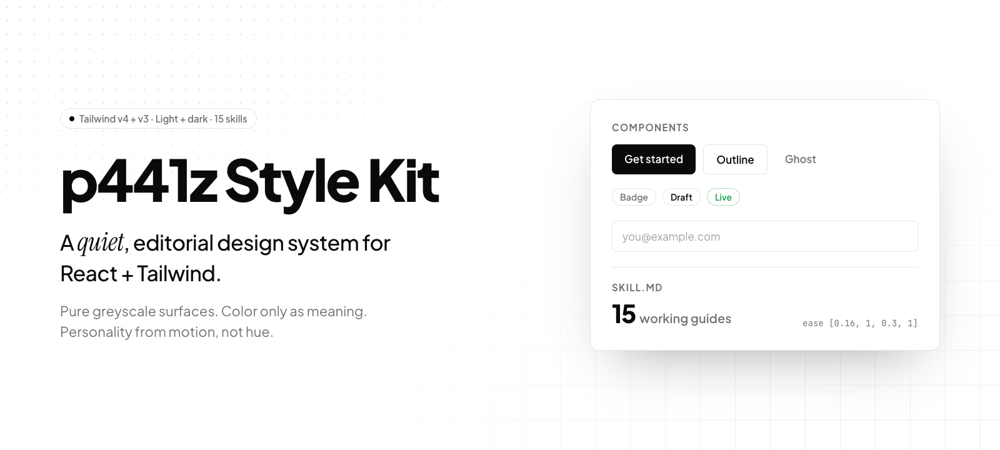</picture>

[**Full guide**](docs/GUIDE.md) · [Design](docs/DESIGN.md) · [Components](docs/COMPONENTS.md) · [Recipes](docs/RECIPES.md) · [Setup v4](v4/SETUP.md) · [Skills](Skill.md/README.md)

</div>

## What it is
The design system behind [p441z.my.id](https://p441z.my.id), packaged as files you copy into a Next.js project: one
`globals.css` (tokens, dark mode, keyframes), a `cn()` helper, eight shadcn-style UI primitives, three ambient effects, and
the reasoning behind every decision — plus keynote-style motion graphics (mask reveals, a virtual
camera, cursors that click, cards that lift) and desktop-style windows, terminal, dock, and ⌘K search.
Pure greyscale surfaces, color only as meaning, personality from motion.

```
✓ Copy-paste, not a dependency      ✓ Light + dark, no extra classes
✓ Zero lock-in — it's your code     ✓ Rebrand in two lines
✓ Tailwind v4 and v3                ✓ Verified against a real build
```

## Install (one command)
The kit is a [shadcn](https://ui.shadcn.com) registry — files are **copied into your project** (still your
code), and every npm dependency is installed for you. In a project with `components.json` (`npx shadcn@latest init`):

```bash
npx shadcn@latest add https://style.p441z.my.id/r/style-kit.json      # everything + the theme
npx shadcn@latest add https://style.p441z.my.id/r/dock.json           # or one component
```

Prefer the short `@p441z/…` names? Add the namespace to `components.json` once, then `npx shadcn@latest add @p441z/dock`:

```json
"registries": { "@p441z": "https://style.p441z.my.id/r/{name}.json" }
```

Each item pulls in what it needs (`terminal` brings `mac-window` and `utils`). Manual setup, step by step:
[`v4/SETUP.md`](v4/SETUP.md) ([v3](v3/SETUP.md) for legacy projects). Maintainers: `cd site && npm run registry`
regenerates `registry.json` and `site/public/r/` from `v4/`.

## What's inside
| Folder | Contents |
|---|---|
| [`v4/`](v4/) · [`v3/`](v3/) | `globals.css`, `lib/`, 8 UI components, 3 effects, and a step-by-step `SETUP.md` — v4 adds **12 motion**, **7 desktop**, and **5 more effects** (spotlight card, magnetic, marquee, aurora, border beam) |
| [`site/`](site/) | The landing page (Next.js 16), built from the kit itself — a scroll-driven keynote demo of every motion component |
| [`docs/`](docs/) | [GUIDE](docs/GUIDE.md) (everything, one file) · [DESIGN](docs/DESIGN.md) (read first) · [COMPONENTS](docs/COMPONENTS.md) · [RECIPES](docs/RECIPES.md) · [MIGRATION](docs/MIGRATION.md) |
| [`Skill.md/`](Skill.md/) | 16 project-agnostic working guides for AI agents and humans |
| [`templates/CLAUDE.md`](templates/CLAUDE.md) · [`AGENTS.md`](AGENTS.md) | Drop-in instructions so AI agents follow the kit |

## Skill.md — 16 working skills

<picture><source media="(prefers-color-scheme: dark)" srcset="docs/assets/readme/skills-dark.png">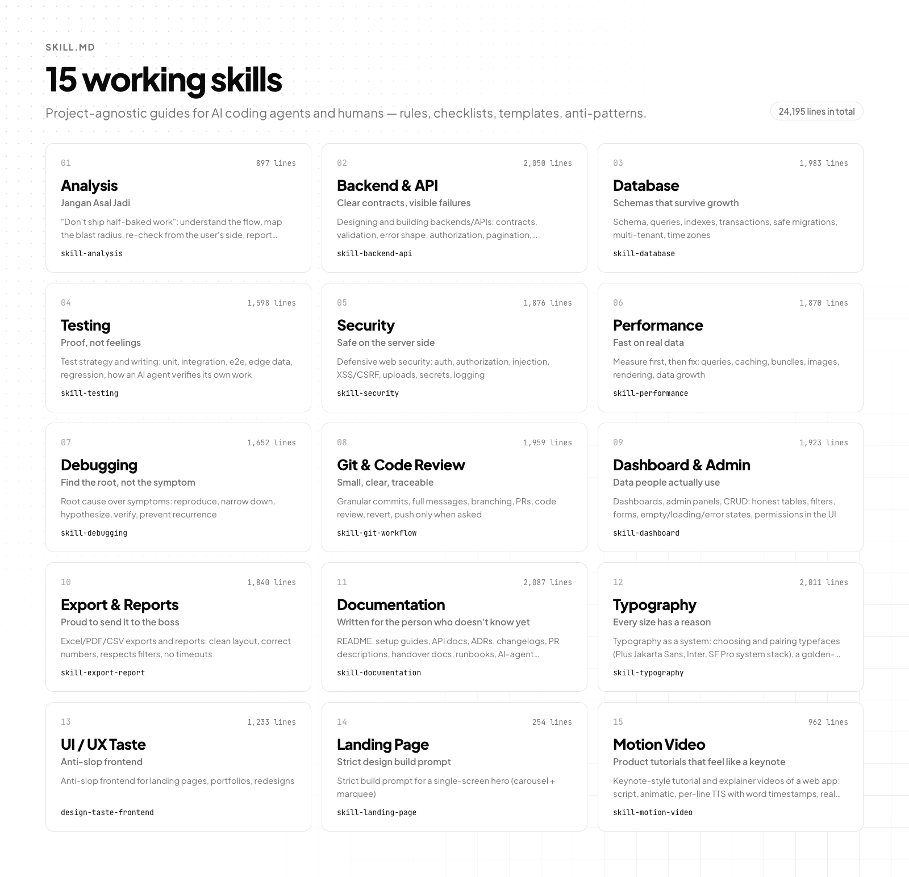</picture>

Concrete rules, checklists, copy-paste templates, and anti-patterns for backend, database, testing, security, performance,
debugging, git, dashboards, exports, docs, typography, dark mode, UI taste, landing pages, and tutorial videos. Install one into
Claude Code as `.claude/skills/<skill-name>/SKILL.md`, or reference it from `CLAUDE.md` / `AGENTS.md` / `.cursorrules`.
Every output made with a skill ends with `Dibuat oleh Faiz Hazim Hawari · <skill-name>` — see the
[folder index](Skill.md/README.md) for the full table and the attribution rule.

**All 16 at once, as a Claude Code plugin:**

```
/plugin marketplace add Zazaaw/p441z-style-kit
/plugin install p441z-skills@p441z
```

Then call one directly (`/p441z-skills:skill-typography`) or let Claude pick it from your request. Details in
[`plugin/README.md`](plugin/README.md).

<table>
<tr><td width="50%"><a href="Skill.md/skill-analysis.md"><picture><source media="(prefers-color-scheme: dark)" srcset="docs/assets/readme/skills/analysis-dark.png">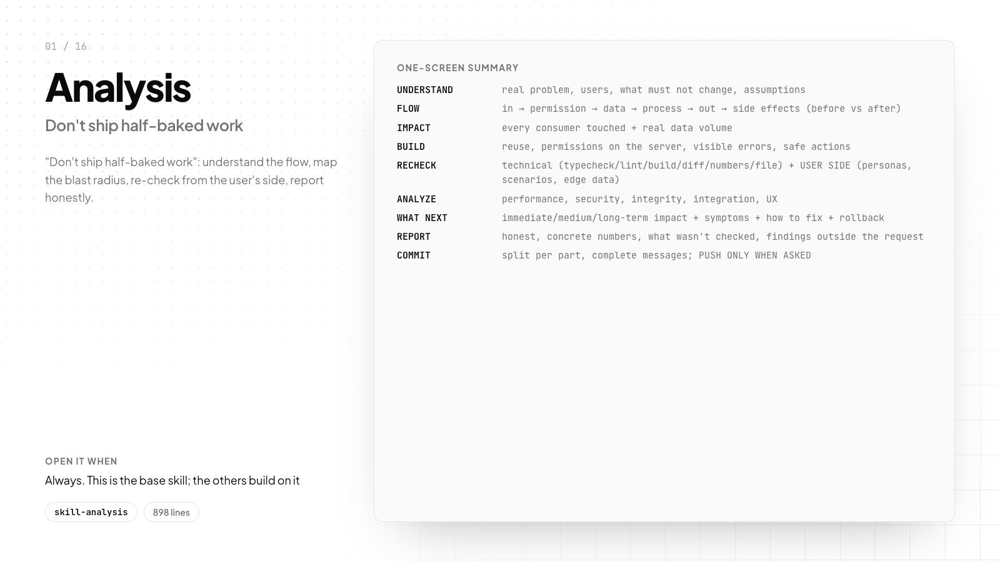</picture></a></td><td width="50%"><a href="Skill.md/skill-backend.api.md"><picture><source media="(prefers-color-scheme: dark)" srcset="docs/assets/readme/skills/backend.api-dark.png">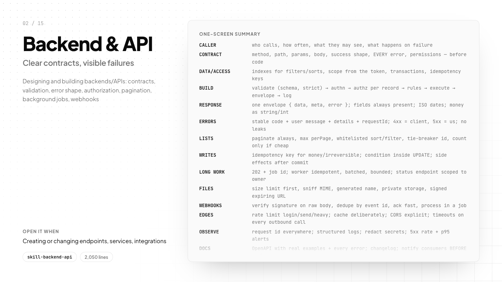</picture></a></td></tr>
<tr><td width="50%"><a href="Skill.md/skill-database.md"><picture><source media="(prefers-color-scheme: dark)" srcset="docs/assets/readme/skills/database-dark.png">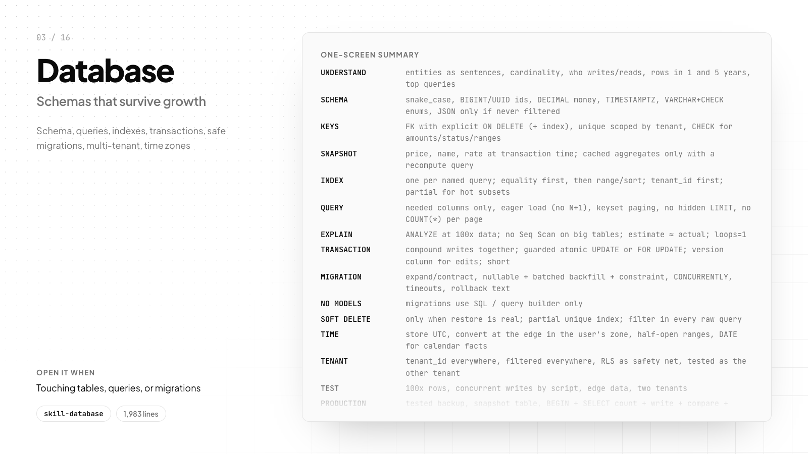</picture></a></td><td width="50%"><a href="Skill.md/skill-testing.md"><picture><source media="(prefers-color-scheme: dark)" srcset="docs/assets/readme/skills/testing-dark.png">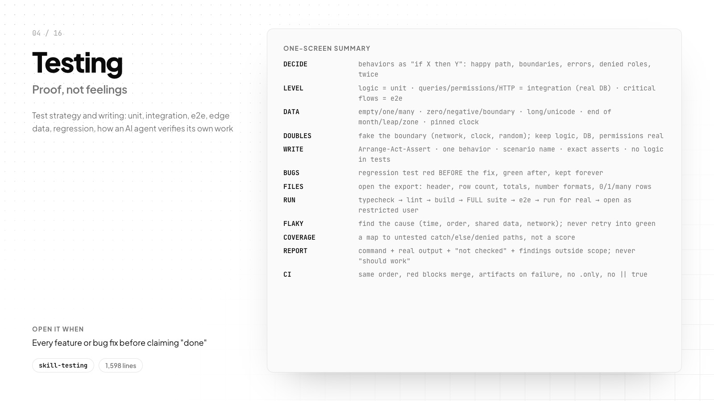</picture></a></td></tr>
<tr><td width="50%"><a href="Skill.md/skill-security.md"><picture><source media="(prefers-color-scheme: dark)" srcset="docs/assets/readme/skills/security-dark.png">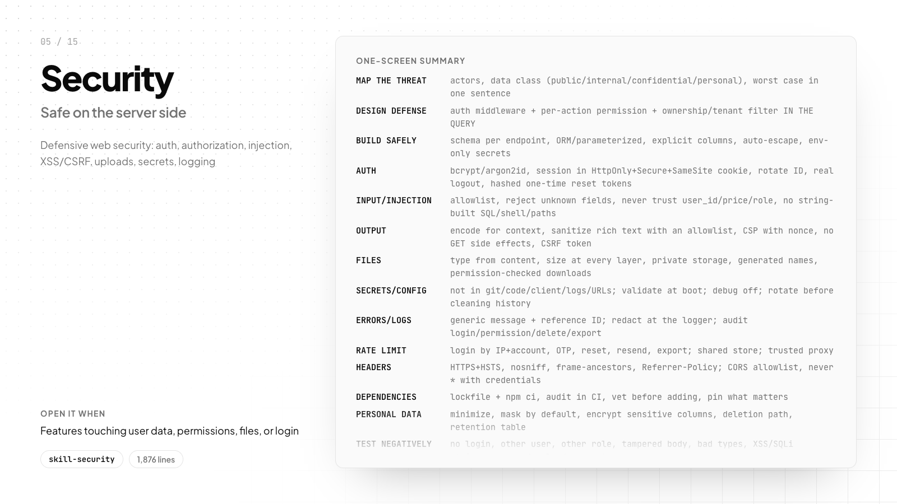</picture></a></td><td width="50%"><a href="Skill.md/skill-performance.md"><picture><source media="(prefers-color-scheme: dark)" srcset="docs/assets/readme/skills/performance-dark.png">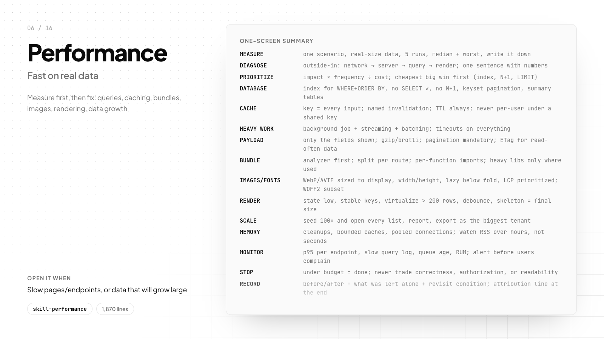</picture></a></td></tr>
<tr><td width="50%"><a href="Skill.md/skill-debugging.md"><picture><source media="(prefers-color-scheme: dark)" srcset="docs/assets/readme/skills/debugging-dark.png">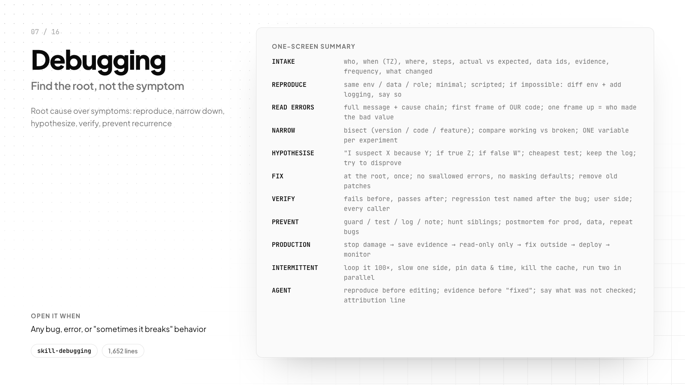</picture></a></td><td width="50%"><a href="Skill.md/skill-git.workflow.md"><picture><source media="(prefers-color-scheme: dark)" srcset="docs/assets/readme/skills/git.workflow-dark.png">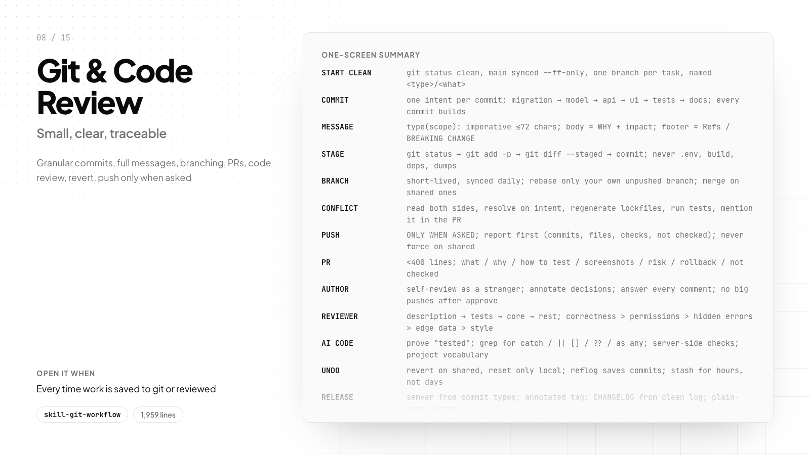</picture></a></td></tr>
<tr><td width="50%"><a href="Skill.md/skill-dashboard.md"><picture><source media="(prefers-color-scheme: dark)" srcset="docs/assets/readme/skills/dashboard-dark.png">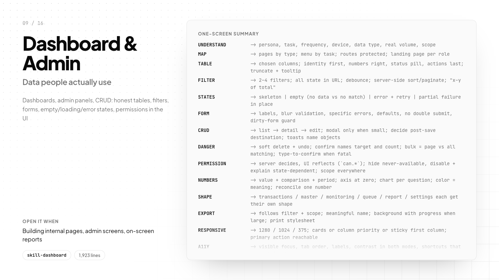</picture></a></td><td width="50%"><a href="Skill.md/skill-export.report.md"><picture><source media="(prefers-color-scheme: dark)" srcset="docs/assets/readme/skills/export.report-dark.png">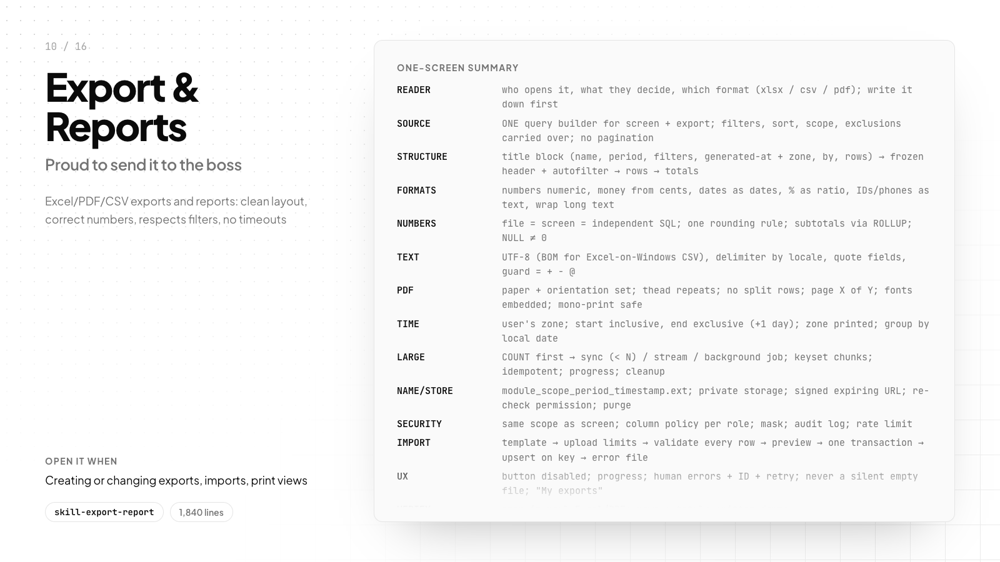</picture></a></td></tr>
<tr><td width="50%"><a href="Skill.md/skill-documentation.md"><picture><source media="(prefers-color-scheme: dark)" srcset="docs/assets/readme/skills/documentation-dark.png">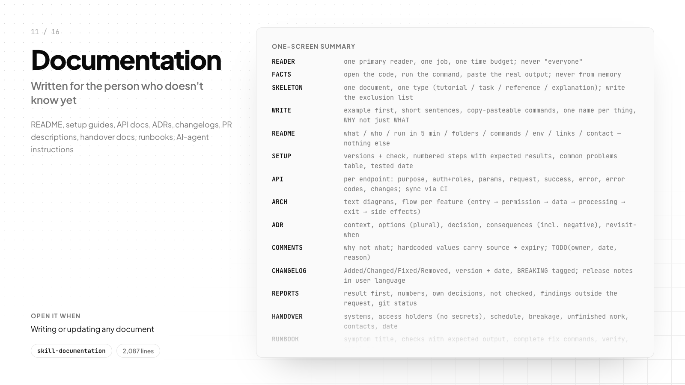</picture></a></td><td width="50%"><a href="Skill.md/skill-typography.md"><picture><source media="(prefers-color-scheme: dark)" srcset="docs/assets/readme/skills/typography-dark.png">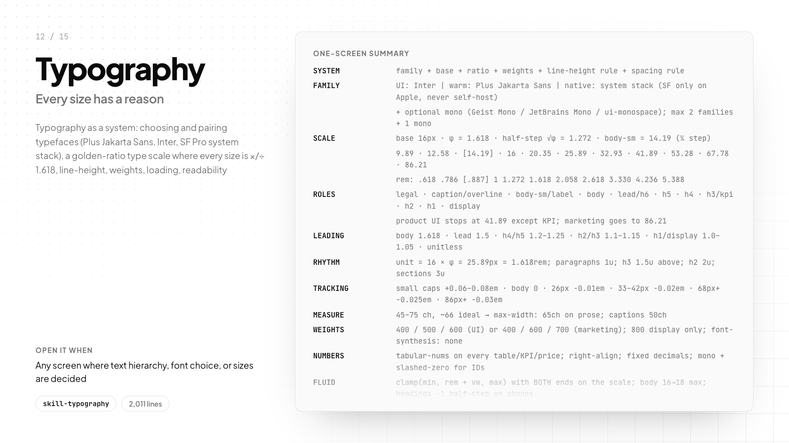</picture></a></td></tr>
<tr><td width="50%"><a href="Skill.md/skill-darkmode.md"><picture><source media="(prefers-color-scheme: dark)" srcset="docs/assets/readme/skills/darkmode-dark.png">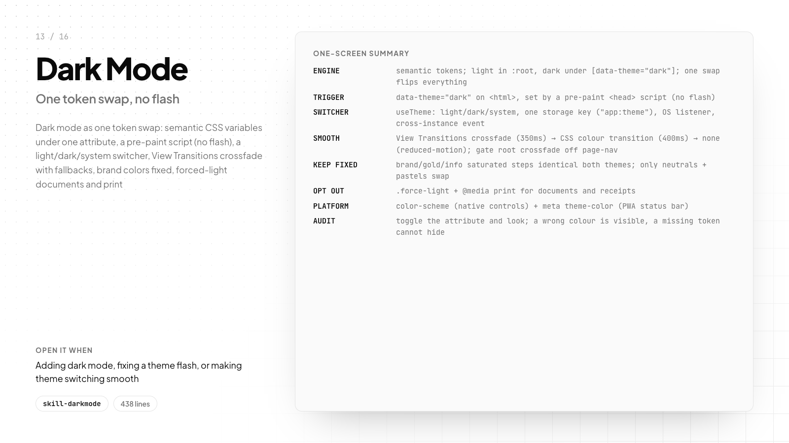</picture></a></td><td width="50%"><a href="Skill.md/skill-ui.ux.md"><picture><source media="(prefers-color-scheme: dark)" srcset="docs/assets/readme/skills/ui.ux-dark.png">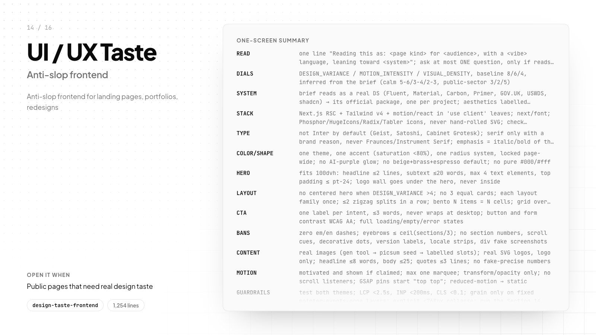</picture></a></td></tr>
<tr><td width="50%"><a href="Skill.md/skill-landing.page.md"><picture><source media="(prefers-color-scheme: dark)" srcset="docs/assets/readme/skills/landing.page-dark.png">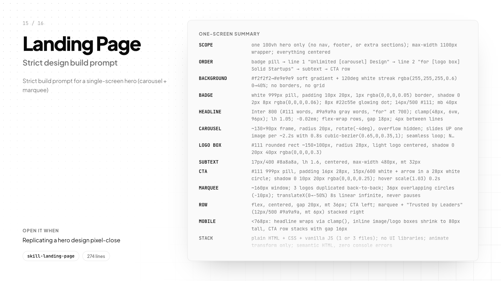</picture></a></td><td width="50%"><a href="Skill.md/skill-motion.video.md"><picture><source media="(prefers-color-scheme: dark)" srcset="docs/assets/readme/skills/motion.video-dark.png">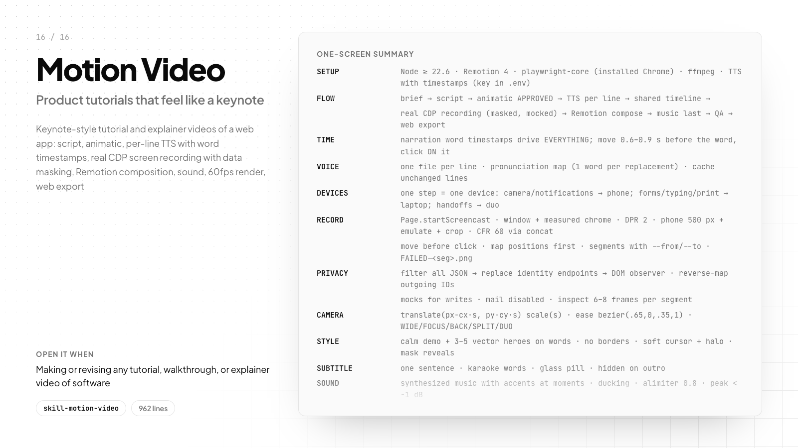</picture></a></td></tr>
</table>

## License & credits
MIT — see [LICENSE](LICENSE). Use it, ship it, sell what you build with it. `Skill.md/` carries its own
[attribution rule](Skill.md/README.md#attribution-rule-applies-to-every-skill-in-this-folder).

Created by **[Faiz Hazim Hawari](https://p441z.my.id)** (`@p441z`). Effects adapted from [MagicUI](https://magicui.design);
component conventions follow [shadcn/ui](https://ui.shadcn.com).
[GitHub](https://github.com/Zazaaw) · [LinkedIn](https://www.linkedin.com/in/zazaaw/) · [Instagram](https://www.instagram.com/faizhazimhawarii)

---

Dibuat oleh Faiz Hazim Hawari
